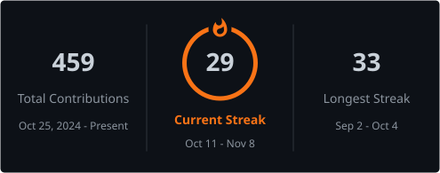

# Hey, I'm Reymund Angelo M. Abelgas

**Full-Stack Developer** · Mati City, Davao Oriental, Philippines

I ship cross-platform web and mobile products for schools, disaster response, and local services — from system design through deployment. I prefer systems that hold up outside a demo: clear admin tooling, thoughtful architecture, and deployments that stay online.

- 💼 Open to freelance work and full-stack roles
- 🎓 BS Information Technology (Mobile Systems Development) at Davao Oriental State University

---

## Projects

### [Respondr](https://respondr-da5cb.web.app/)
Emergency coordination for PDRRMO Davao Oriental — offline-capable resource ops, live municipal maps, SitReps, and weather monitoring.

Expo · React Native · Firebase · Leaflet · [Repo](https://github.com/Kyosue/respondr) · [Live](https://respondr-da5cb.web.app/)

### [TAVI](https://tavi-ph.vercel.app/)
Transport Access for Vehicle Identification — passengers in Mati City scan a QR sticker to open a human-reviewed Bao-bao or tricycle record (body number, plate, route, photos) in any phone browser. No app, no account.

Next.js · Supabase · [Live](https://tavi-ph.vercel.app/) · source private

### [Attendify](https://attendify-pnhs.web.app/)
School attendance and campus presence — QR check-in, geofencing, role-based admin, and Excel reports for 70+ sections.

Expo · React Native · Firebase · Leaflet · [Repo](https://github.com/Kyosue/Attendify) · [Live](https://attendify-pnhs.web.app/)

---

## Stack

<picture>
  <source media="(prefers-color-scheme: light)" srcset="https://skillicons.dev/icons?i=js,ts,php,html,css,react,nextjs,nodejs,express,firebase,supabase,mongodb,mysql,vercel,netlify,git&theme=light" />
  
</picture>

---

## GitHub stats

  <picture>
    <source media="(prefers-color-scheme: light)" srcset="./profile/stats-light.svg" />
    
  </picture>
  <picture>
    <source media="(prefers-color-scheme: light)" srcset="./profile/streak-light.svg" />
    
  </picture>

