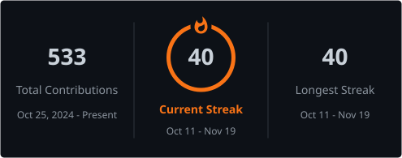

# Hey, I'm Reymund Angelo M. Abelgas

**Full-Stack Developer** · Mati City, Davao Oriental, Philippines

I ship cross-platform web and mobile products for schools, disaster response, and local services — from system design through deployment. I prefer systems that hold up outside a demo: clear admin tooling, thoughtful architecture, and deployments that stay online.

- 💼 Open to freelance work and full-stack roles
- 🎓 BS Information Technology (Mobile Systems Development) at Davao Oriental State University

---

## Projects

<table>
<tr>
<td width="50%" valign="top">

### Kitra
RENTAL SAAS · MULTI-TENANT

Rental and inventory platform for equipment, event, camera, gown and vehicle shops. Online reservations, a public live-availability catalog, QR check-out and returns from a staff app with an offline queue, and a ledger-backed stock history. The database refuses double-bookings.

`Next.js` `Expo` `Supabase` `Turborepo`

🚧 In development · 🔒 Source private

</td>
<td width="50%" valign="top">

### [Respondr](https://respondr-da5cb.web.app/)
DISASTER RESPONSE · PDRRMO DAVAO ORIENTAL

Emergency coordination platform with offline-capable resource operations, live municipal maps, situation reports (SitReps), and weather monitoring.

`Expo` `React Native` `Firebase` `Leaflet`

🌐 [Live](https://respondr-da5cb.web.app/) · 📂 [Source](https://github.com/Kyosue/respondr)

</td>
</tr>
<tr>
<td width="50%" valign="top">

### [TAVI](https://tavi-ph.vercel.app/)
PUBLIC TRANSPORT · MATI CITY

Transport Access for Vehicle Identification. Passengers scan a QR sticker to view a human-reviewed Bao-bao or tricycle record (body number, plate, route, photos) in any phone browser — no app, no account.

`Next.js` `Supabase`

🌐 [Live](https://tavi-ph.vercel.app/) · 🔒 Source private

</td>
<td width="50%" valign="top">

### [Attendify](https://attendify-pnhs.web.app/)
EDUCATION · SCHOOL ATTENDANCE

Attendance and campus presence system with QR check-in, geofencing, role-based administration, and Excel reporting across 70+ sections.

`Expo` `React Native` `Firebase` `Leaflet`

🌐 [Live](https://attendify-pnhs.web.app/) · 📂 [Source](https://github.com/Kyosue/Attendify)

</td>
</tr>
</table>

---

## Stack

<picture>
  <source media="(prefers-color-scheme: light)" srcset="https://skillicons.dev/icons?i=js,ts,php,html,css,react,nextjs,nodejs,express,firebase,supabase,mongodb,mysql,vercel,netlify,git&theme=light" />
  
</picture>

---

## GitHub stats

  <picture>
    <source media="(prefers-color-scheme: light)" srcset="./profile/stats-light.svg" />
    
  </picture>
  <picture>
    <source media="(prefers-color-scheme: light)" srcset="./profile/streak-light.svg" />
    
  </picture>

