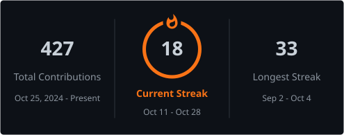
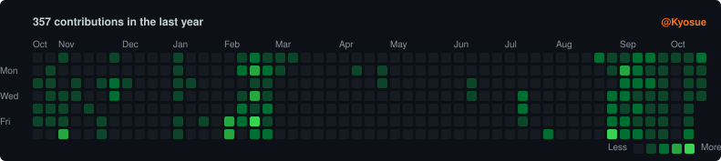

# Hey, I'm Reymund Angelo M. Abelgas

**Full-Stack Developer** · Mati City, Davao Oriental

BS Information Technology (Mobile Systems Development) at Davao Oriental State University.
I ship cross-platform web and mobile products for schools, disaster response, and client work — from system design through deployment.

---

## About me

Work spans full-stack web and mobile — React, Next.js, React Native, Node.js, PHP, and data layers with Firebase, MongoDB, and MySQL. Much of it sits at the intersection of APIs, auth, storage, maps, and QR-driven flows, shaped for real use in schools, disaster operations, and local services.

Prefer systems that hold up outside a demo: clear admin tooling, thoughtful architecture, and deployments on Firebase, Vercel, Render, and Netlify when they need to stay online.

---

## Featured projects

| Project | What it is | Links |
| --- | --- | --- |
| **Respondr** | Cross-platform emergency coordination for PDRRMO Davao Oriental — offline-capable resource ops, live municipal maps, SitReps, and weather monitoring. | [Repo](https://github.com/Kyosue/respondr) · [Live](https://respondr-da5cb.web.app/) |
| **TAVI** | Transport Access for Vehicle Identification — passengers in Mati City scan a QR sticker to open a human-reviewed Bao-bao or tricycle record (body number, plate, route, photos) in any phone browser. No app, no account; identifies the unit, not who is driving today. | [Live](https://tavi-ph.vercel.app/) |
| **Attendify** | Cross-platform school attendance & campus presence — QR check-in, geofencing, role-based admin, and Excel reports for 70+ sections. | [Repo](https://github.com/Kyosue/Attendify) · [Live](https://attendify-pnhs.web.app/) |

---

## Tech stack

<table>
  <tr>
    <td width="50%" valign="top">
      <strong>01 · Languages</strong> 
      What I build with  
      
      
      
      
      
      
      
    </td>
    <td width="50%" valign="top">
      <strong>02 · Frameworks</strong> 
      Web, mobile, and server  
      
      
      
      
      
      
    </td>
  </tr>
  <tr>
    <td width="50%" valign="top">
      <strong>03 · Data &amp; hosting</strong> 
      Storage, media, and deployment  
      
      
      
      
      
      
      
    </td>
    <td width="50%" valign="top">
      <strong>04 · Tools</strong> 
      Workflow and design  
      
      
      
      
    </td>
  </tr>
</table>

---

## GitHub stats

<table>
  <tr>
    <td align="center" width="50%">
      
    </td>
    <td align="center" width="50%">
      
    </td>
  </tr>
</table>

 

<strong>Contribution activity</strong>

---

## Connect

<table width="100%">
  <tr>
    <td align="center" width="25%">
       
      View my work
    </td>
    <td align="center" width="25%">
       
      reymund216@gmail.com
    </td>
    <td align="center" width="25%">
       
      @Kyosue
    </td>
    <td align="center" width="25%">
       
      Philippines
    </td>
  </tr>
</table>

Open to collaboration, freelance work, and full-stack opportunities — feel free to reach out.

---

*Thanks for visiting — always happy to connect.*

